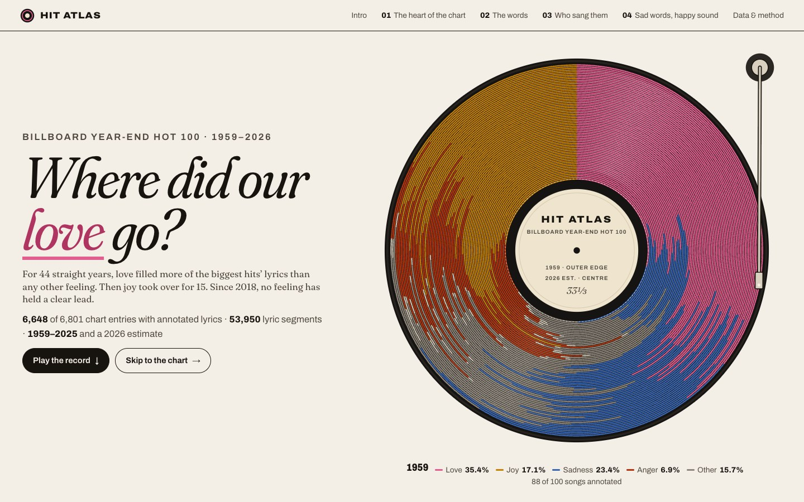
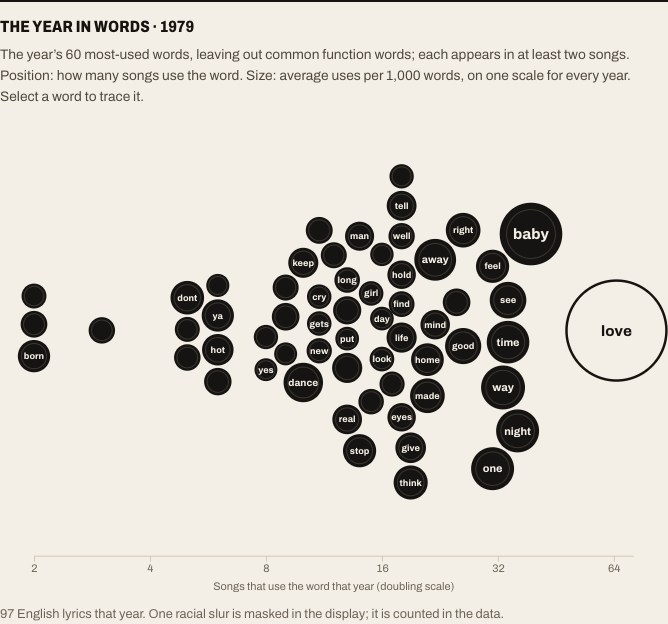
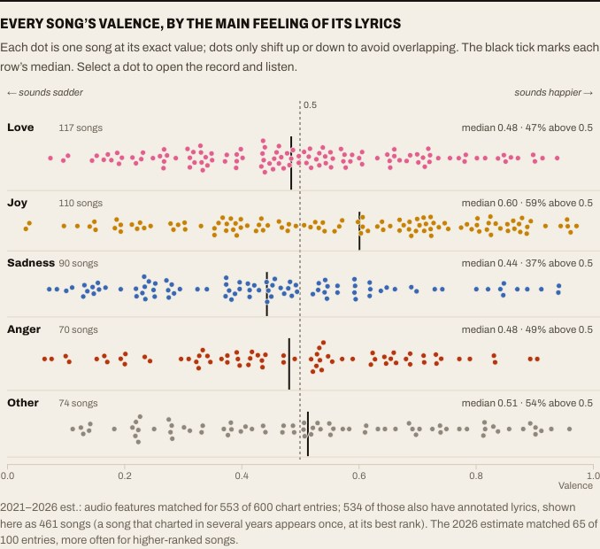

# Hit Atlas

## Where did our love go?

Love led the lyric emotion charts for **44 years**. Then joy took over. Meanwhile, the word *love* stayed near the top of the vocabulary chart even as hit songs used it less.

[**Explore the interactive story**](https://skyexry.github.io/hit-atlas/atlas/)

Hit Atlas explores **6,801 U.S. Billboard Year-End Hot 100 entries** across the published 1959–2025 charts and a 2026 year-to-date estimate. Four interactive D3.js chapters follow lyric emotions, word use, artist origins, and the sound of the recordings.

## Four tracks, four discoveries

### 01 · Love led for 44 years. Joy led for the next 15.

In the model-annotated lyrics, love had the largest share on every chart from **1959 to 2002**. Joy led every year from **2003 to 2017**. Pick a year to open its crate of records, then select a song to see where its lyric emotions change. [Open the chart crate](https://skyexry.github.io/hit-atlas/atlas/#heart).

### 02 · The word “love” fell from 13.4 to 5.1 uses per 1,000 words

Leaving out common function words, *love* ranked first in **59 of 67 published charts**. Its average annual rate fell from **13.4 to 5.1 uses per 1,000 words**, comparing 1959–1999 with 2020–2025. In 1979, the word appeared in 65 of the 97 songs with usable English lyrics. [Explore the word bubbles and trends](https://skyexry.github.io/hit-atlas/atlas/#words).

### 03 · In 1983, half the credited artists came from outside the U.S.

In that year, **51%** of credited artists with a documented origin came from outside the United States. Select an era, then pick an origin on the map to see the artists and songs behind the share. [Explore artist origins](https://skyexry.github.io/hit-atlas/atlas/#origins).

### 04 · Sad words can come with bright sound

Among **461 songs** with matched audio and annotated lyrics from 2021 through the 2026 estimate, Astra labeled at least half the lyric text sad or angry in 155 songs. **64 of those 155 (41%)** scored above 0.5 on ReccoBeats valence, the audio model's estimate of how positive the music sounds. Switch features or open a song to listen. [Compare the words and the sound](https://skyexry.github.io/hit-atlas/atlas/#sound).

## Data

The [Hit Atlas data dictionary](billboard-year-end/data/README.md) documents the nine core CSVs, original sources, field types, and a public Gist sample. See [coverage and percentages by year](billboard-year-end/data/README.md#coverage-by-year).

The derived lyric data include [word counts, vocabulary diversity, and keyword rankings](billboard-year-end/data/README.md#lyric-features-and-keywords-19592026) and [53,950 segment-level emotion annotations](billboard-year-end/data/emotion/README.md). The emotion tables support song timelines, a five-year comparison of annual top-ten songs, and inspection of model disagreements.

[Download the full segment-level emotion CSV](https://raw.githubusercontent.com/skyexry/hit-atlas/main/billboard-year-end/data/emotion/segment_emotions.csv).

## Run locally

Run `python3 -m http.server` from the repository root and open <http://localhost:8000/atlas/>. See the [Atlas build notes](atlas/README.md) for details, or open the [earlier views and demos](https://skyexry.github.io/hit-atlas/).

## License

The [MIT License](LICENSE) covers the Hit Atlas team's original D3 visualization and Python data-processing code, including original D3 code embedded in HTML. Third-party code, datasets, lyrics, and other source material are outside this grant. See the [data sources](billboard-year-end/data/README.md#sources-and-what-we-did) for provenance and the [bundled D3 license](billboard-year-end/site/D3-LICENSE.txt) for D3's terms.
