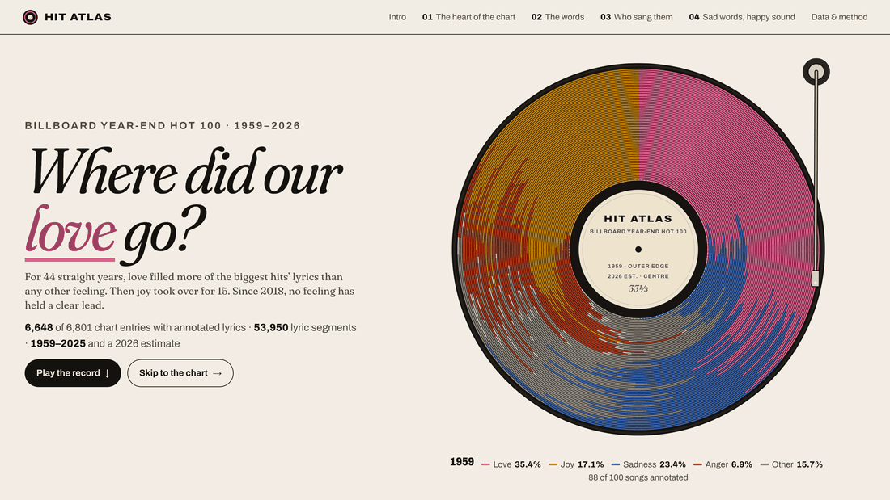
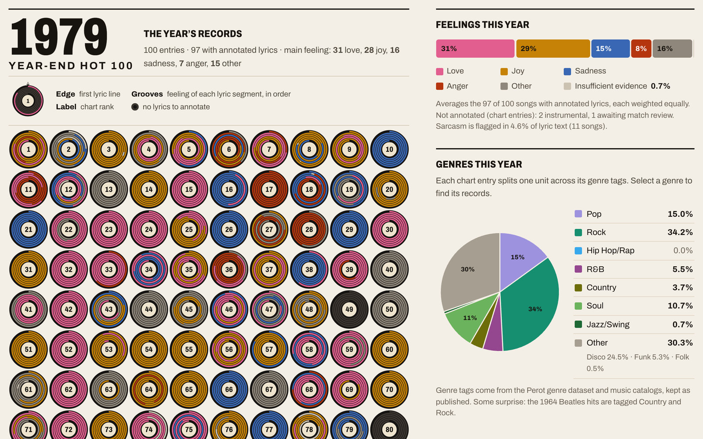
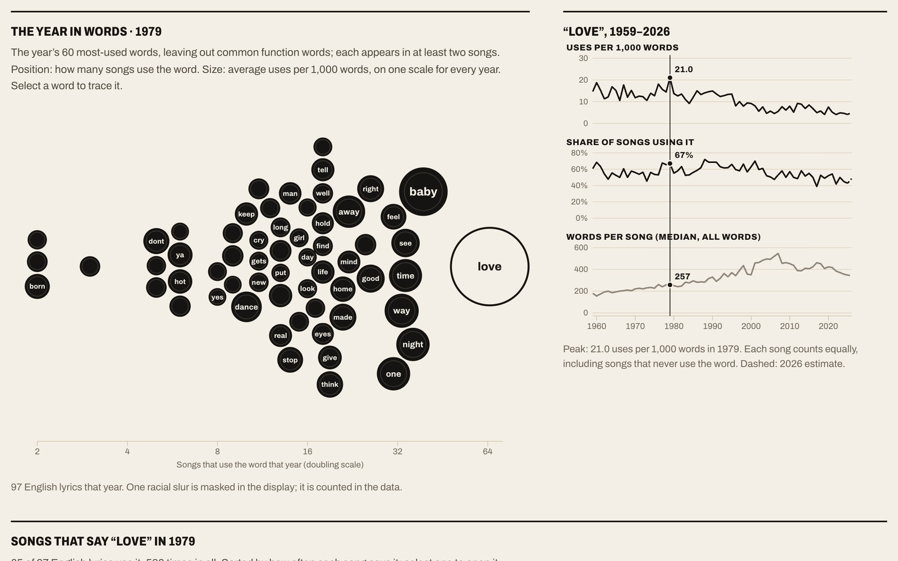
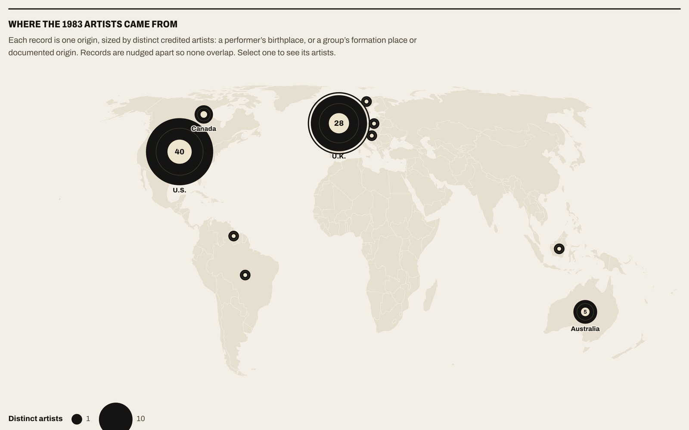
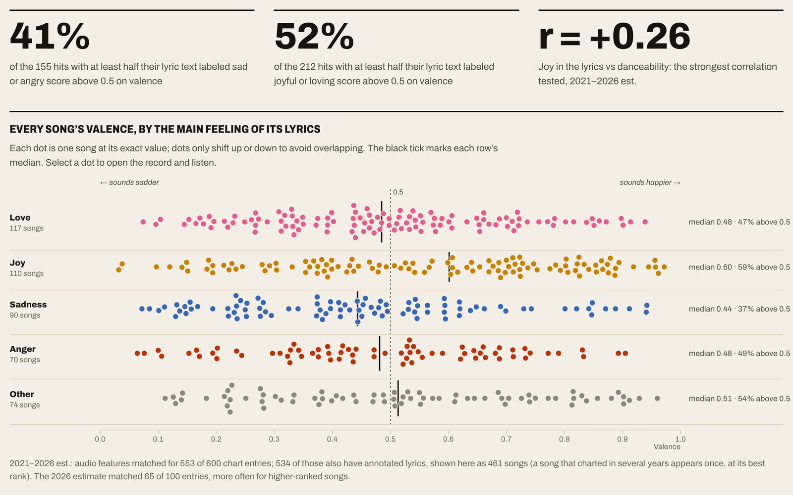
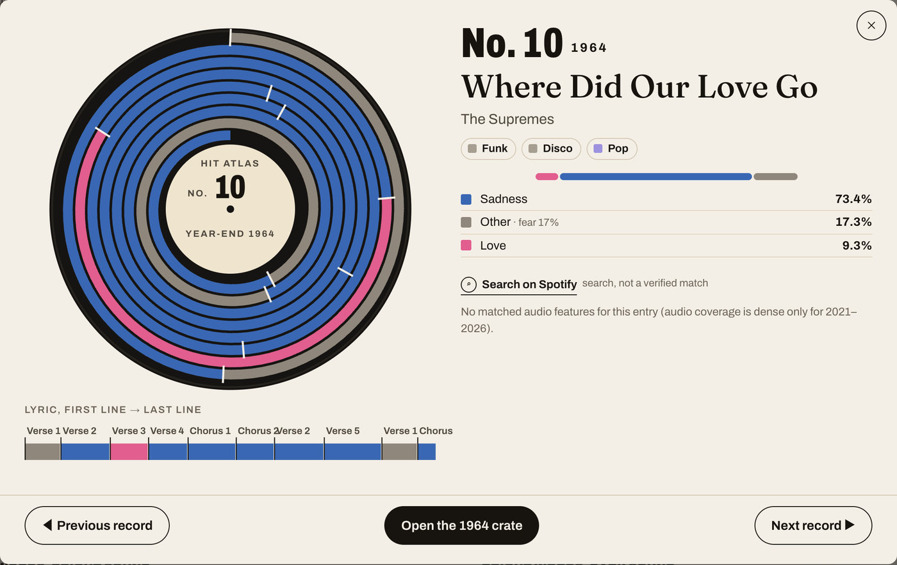

<p align="center">
  <a href="https://skyexry.github.io/hit-atlas/atlas/"></a>
</p>

<h1 align="center">Hit Atlas</h1>

<p align="center"><b>Where did our love go?</b> Sixty-eight years of Billboard Year-End Hot 100 hits, read groove by groove.</p>

<p align="center">
  <a href="https://skyexry.github.io/hit-atlas/atlas/"><b>▶ Play the record</b></a> &nbsp;·&nbsp;
  <a href="billboard-year-end/data/README.md">The data</a> &nbsp;·&nbsp;
  <a href="atlas/README.md">How it’s built</a> &nbsp;·&nbsp;
  <a href="https://skyexry.github.io/hit-atlas/">Earlier views</a>
</p>

Hit Atlas is an interactive D3.js story about how America’s biggest hits changed: what their lyrics feel, which words they use, where their artists come from, and how they sound. Every song is drawn as a record. Its groove follows the lyric from the first line at the edge to the last line at the label, colored by the feeling of each segment.

## Tracklist

<table>
  <tr>
    <td width="50%" valign="top">
      <a href="https://skyexry.github.io/hit-atlas/atlas/?year=1979#chart-crate"></a>
      <p><b><a href="https://skyexry.github.io/hit-atlas/atlas/?year=1979#chart-crate">01 · The heart of the chart</a></b><br>Love led every chart from 1959 to 2002. Joy led the next 15. Open any year’s crate of 100 records.</p>
    </td>
    <td width="50%" valign="top">
      <a href="https://skyexry.github.io/hit-atlas/atlas/?year=1979#word-explorer"></a>
      <p><b><a href="https://skyexry.github.io/hit-atlas/atlas/?year=1979#word-explorer">02 · The words</a></b><br>“Love” topped 59 of 67 charts, yet fell from 13.4 to 5.1 uses per 1,000 words. Search any word.</p>
    </td>
  </tr>
  <tr>
    <td width="50%" valign="top">
      <a href="https://skyexry.github.io/hit-atlas/atlas/?year=1983#artist-map"></a>
      <p><b><a href="https://skyexry.github.io/hit-atlas/atlas/?year=1983#artist-map">03 · Who sang them</a></b><br>In 1983, half the chart’s artists came from outside the U.S., most of them British.</p>
    </td>
    <td width="50%" valign="top">
      <a href="https://skyexry.github.io/hit-atlas/atlas/#sound-tiles"></a>
      <p><b><a href="https://skyexry.github.io/hit-atlas/atlas/#sound-tiles">04 · Sad words, happy sound</a></b><br>41% of 2021–2026 hits with mostly sad or angry lyrics still sound bright. Listen to the exceptions.</p>
    </td>
  </tr>
</table>

## One record, up close

<p align="center"></p>

The Supremes’ “Where Did Our Love Go” (No. 10, 1964) gives the project its title, and its lyric is 73% sadness. Select any record on the site to see its sections, its feelings, and where to listen.

## Liner notes

| Chart entries | Songs | Artists | Lyric segments | English lyrics indexed | Matched recordings |
| ---: | ---: | ---: | ---: | ---: | ---: |
| 6,801 | 6,451 | 2,838 | 53,950 | 6,216 | 629 |

- **[Data dictionary](billboard-year-end/data/README.md)**: the nine core tables, sources, and [coverage by year](billboard-year-end/data/README.md#coverage-by-year).
- **[Lyric emotions](billboard-year-end/data/emotion/README.md)**: segment annotations, song and annual summaries, and the model comparison.
- **[Build notes](atlas/README.md)**: how the page’s data file is built and checked against the published CSVs.

The charts cover the published 1959–2025 Year-End Hot 100 and a 2026 year-to-date estimate. Feelings are model annotations of lyric text, and audio features come from the recording matched to each entry.

## Run it locally

```sh
python3 -m http.server
```

Then open <http://localhost:8000/atlas/>. There is no build step. To rebuild the page data, run `python3 billboard-year-end/scripts/build_atlas_data.py`. To refresh these README images, run `node assets/src/capture.mjs`.

## License

The [MIT License](LICENSE) covers the Hit Atlas team’s original D3 visualization and Python data-processing code, including original D3 code embedded in HTML. Third-party code, datasets, lyrics, and other source material are outside this grant. See the [data sources](billboard-year-end/data/README.md#sources-and-what-we-did) for provenance and the [bundled D3 license](billboard-year-end/site/D3-LICENSE.txt) for D3’s terms.
