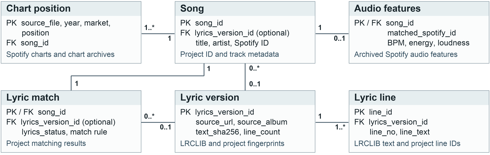

# Hit Atlas field sources

The diagram shows the current song-level joins. A chart position joins to a song via `song_id`. The song can link to one default lyric version and one archived audio record. Multiple songs can share a lyric version. Lyric scores will join by `lyrics_version_id` and word evidence by `line_id`.

## Data sources

- **Chart data.** Earlier global charts use Wrapped playlists, announcements, archived snapshots and published playlist exports. The 2026 global estimate uses weekly Top 200 chart observations. Regional estimates use the daily archive for January 1 through November 12 of each year. [Source register](../Spotify基础数据集/榜单来源.csv) · [Weekly archive](https://zenodo.org/records/23644526) · [Regional daily charts](https://www.kaggle.com/datasets/gonzalopezgil/spotify-charts-daily-updated/versions/173)
- **Recording metadata.** Read the individual `metadata_source` or chart-side provenance for each match. Sources include Spotify track and playlist metadata, Deezer, MGD+, cached Spotify exports and corroborating reports for some historical credits.
- **Lyrics.** The default transcription was selected from LRCLIB candidates. Source metadata and text are preserved with a project version key and line order. [LRCLIB API](https://lrclib.net/docs) · [Matching rules](../Spotify基础数据集/歌曲与歌词/使用说明.md)
- **Audio.** The feature table imports Spotify Audio Features from MGD+, archived annual data, Kaggle exports, and the P-Arpan combined dataset. Source and match are recorded per row. [MGD+](https://zenodo.org/records/8086643) · [Merged audio corpus](https://huggingface.co/datasets/P-Arpan/Mood_Based_Music_Search) · [Source priority rules](../Spotify基础数据集/音乐特征/README.md)

In 2024–2026, the global Top 50 contains 150 chart positions with 150 default lyric links, 56 metadata-checked lyric links, and 50 links with the six baseline audio features. The regional sample has 3,450 positions with 3,397 default lyric links, 1,659 metadata-checked lyric links, and 479 links with baseline audio features. These are chart-position counts. The working corpus has 2,963 songs, 2,832 default lyric versions and 601 matched audio rows.

Emotion-word rates and repeat-line share are planned derived fields. The team will compute them from the selected lyrics using its documented tokenizer, NRC dictionary and scoring rules. Theme labels and embedding coordinates are optional future outputs.

## Chart positions

A chart position in one source. The key is `source_file + year + market + position`. [CSV](../Spotify基础数据集/歌曲与歌词/榜位对应.csv)

| Field | Type | Source or construction |
|---|---|---|
| `song_id` | ID | Project-generated ID assigned by the recording match. Foreign key to the song master. |
| `year`, `market`, `position` | Integer, text, integer | Spotify Wrapped, playlist archives, or the project aggregation of regional daily or global weekly Spotify charts. For an official playlist, position is its source order. |
| `track_title`, `artist_credit` | Text | Title and credit as carried by the corresponding chart source. |
| `analysis_set` | Category | Project curation of annual sources into main sample, historical supplement, or extended source list. |
| `record_status` | Category | Project label for a historical annual record or an in-year estimate. |
| `market_scope` | Category | Project label from the chart market, global or regional. |
| `chart_id` | ID | Project label for the annual source chart. |
| `spotify_track_id` | ID | Track ID carried by an annual source or recovered from a corroborating source, as recorded in id_provenance. |
| `id_provenance` | Category | Project record of how the chart-side Spotify ID was obtained, such as a source playlist, a corroborating chart or an MGD+ prefix match. |
| `source_type`, `source_url` | Category, URL | Type and URL of the row’s original chart source. See the chart source register. |
| `observed_weekly_top200_streams` | Integer | Sum of observed Spotify Global Top 200 weekly streams for the 2026 year-to-date estimate. |
| `window_start`, `window_end` | Date | Project dates specifying which daily or weekly chart observations enter an aggregate. |
| `source_file` | Text | Project CSV filename from which the chart row was imported. |
| `observed_daily_chart_streams` | Integer | Sum of observed regional daily chart streams within the common period. |
| `chart_entries` | Integer | Number of daily chart records aggregated for the title and artist credit. A date can contribute multiple records. |
| `observed_days` | Integer | Distinct observation dates in the market’s regional chart window. |
| `in_three_year_panel` | Boolean | Project flag for markets that satisfy the common-window coverage rule in each of 2024, 2025, and 2026. |
| `recording_link_status` | Category | Project result describing the chart-to-song link, including direct ID, normalized title/credit or a grouped chart row. |

## Song master

One project song or recording entry, keyed by `song_id`. [CSV](../Spotify基础数据集/歌曲与歌词/歌曲母表.csv)

| Field | Type | Source or construction |
|---|---|---|
| `song_id` | ID | Stable project ID for the song or recording entry. |
| `title`, `artist` | Text | Project display title and credit taken from Spotify charts or track metadata, with corroboration from the sources below where available. |
| `spotify_id` | ID | Spotify recording catalogue ID, taken from chart metadata or the project’s corroborated match. |
| `duration_s` | Number (s) | Recording duration from the row’s metadata source, including Spotify catalogue, Deezer, MGD+ or cached Spotify catalogue exports. |
| `metadata_source` | URL | Per-row link to the metadata or corroborating source. A blank value denotes missing source information for that match. |
| `lyrics_version_id` | ID | Project-selected default LRCLIB transcription, linked to the lyric-version table when available. |

## Lyric match

One decision per song, keyed by `song_id`. [CSV](../Spotify基础数据集/歌曲与歌词/歌词匹配.csv)

| Field | Type | Source or construction |
|---|---|---|
| `song_id` | ID | Foreign key to the project song master. |
| `lyrics_version_id` | ID | The same selected version as in the song master. Blank where a usable lyric could not be linked. |
| `lyrics_status` | Category | Project outcome for candidate selection and recording-metadata checks. |
| `lyrics_match_rule` | Text | Project explanation of the selection rule applied. |
| `identity` | Category | Project recording-identity or candidate-match status. |

## Lyric versions

One frozen LRCLIB transcription, keyed by `lyrics_version_id`. [CSV](../Spotify基础数据集/歌曲与歌词/歌词版本.csv)

| Field | Type | Source or construction |
|---|---|---|
| `lyrics_version_id` | ID | Project version key built from the LRCLIB candidate ID and a normalized-text fingerprint. |
| `source_url` | URL | LRCLIB endpoint for the selected candidate record. |
| `source_title`, `source_artist`, `source_album`, `source_duration_s` | Text, text, text, number (s) | Title, artist, album, and duration returned by LRCLIB for that candidate. These are the lyric provider’s copy of the recording metadata. |
| `text_sha256` | Text | Project SHA-256 checksum of the stored lyric lines joined by newline characters. |
| `line_count` | Integer | Project count of stored lines after transcript preparation. |

## Lyric lines

One occurrence of a line in a transcription, keyed by `line_id`. [CSV](../Spotify基础数据集/歌曲与歌词/逐行歌词.csv)

| Field | Type | Source or construction |
|---|---|---|
| `line_id` | ID | Project-generated version-and-line-number identifier. |
| `lyrics_version_id` | ID | Foreign key to the selected LRCLIB transcription. |
| `line_no` | Integer | Project sequence number after extracting lines, starting at 1. |
| `line_text` | Text | LRCLIB lyric text prepared as lines, with repeated sung lines retained. |

## Lyric candidates for review

One review record per song with a provisional selected candidate. [CSV](../Spotify基础数据集/歌曲与歌词/歌词待复核.csv)

| Field | Type | Source or construction |
|---|---|---|
| `song_id`, `lyrics_version_id` | ID, ID | Project keys for the song and its selected default transcript. |
| `title`, `artist` | Text | Copies of the corresponding song master fields for review. |
| `artist_hint` | Text | Corroborating credit used by the project when a historical chart row lacks an artist credit. |
| `reason` | Text | Project reason the selected candidate awaits review. |
| `distinct_texts` | Integer | Project count of distinct normalized transcriptions among candidates in the preferred matching tier. |
| `candidate_ids` | List of IDs | LRCLIB IDs of retained candidates, separated by pipes. |

## Audio features

One matched recording per song, keyed by `song_id`. [CSV](../Spotify基础数据集/音乐特征/song_audio_features.csv)

| Field | Type | Source or construction |
|---|---|---|
| `song_id` | ID | Foreign key to the project song master. |
| `matched_spotify_id` | ID | Full Spotify ID used for the exact catalogue join. |
| `tempo_bpm`, `loudness_db` | Number (BPM), number (dB) | Spotify Audio Features estimates from the selected archive row. |
| `energy`, `danceability`, `acousticness`, `audio_valence`, `instrumentalness`, `speechiness`, `liveness` | Number (0–1) | Spotify Audio Features scores from the selected archive row. Audio valence refers to the recording’s perceived musical positiveness. |
| `key`, `mode`, `time_signature` | Integer | Spotify Audio Features tonal and meter estimates. Meter values from the merged library are left blank because it includes imputed values. |
| `feature_method` | Text | Project label identifying the source metric family, Spotify Audio Features. |
| `audio_source`, `audio_source_url`, `audio_source_record` | Text, URL, text | Project provenance from the selected archived source, including the dataset and original file or record locator. |
